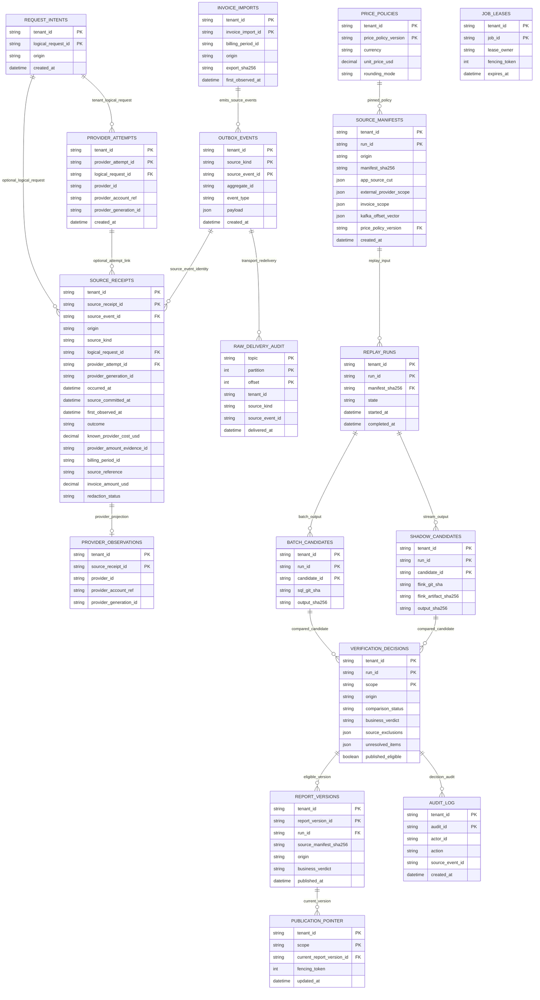

# Planned Core ERD and v1 schema-field map

**State: planned, not implemented.** This diagram makes the storage names from `ARCHITECTURE_DECISIONS.md` §4 reviewable and adds planned `raw_delivery_audit` storage for D2 transport coordinates. It is not DDL, a migration, or evidence that a table exists. Tenant-scoped keys are composite; `tenant_id` is derived by the server from verified auth.

## Planned key constraints and history marks

| Identity / table | Planned key or constraint | Planned history behavior |
|---|---|---|
| `logical_request_id` | Unique/PK `(tenant_id, logical_request_id)` in `request_intents` | Append-only intent history. |
| `provider_attempt_id` | Unique/PK `(tenant_id, provider_attempt_id)` in `provider_attempts` | Append-only; each actual retry is a new attempt. |
| `provider_generation_id` | Partial unique `(provider_id, provider_account_ref, provider_generation_id) WHERE provider_generation_id IS NOT NULL`; each generation maps to at most one attempt | Nullable until observed; observations are append-only. |
| `source_event_id` | PK `(tenant_id, source_kind, source_event_id)` in `outbox_events` | Stable across redelivery; outbox retention/archival policy is not implemented here. |
| `source_receipt_id` | PK/unique `(tenant_id, source_receipt_id)` in `source_receipts` | One ID per persisted observation; append-only. |
| `tenant_id` | Derived from verified auth; leading component of tenant-owned composite keys/FKs | Never sourced from an untrusted payload. |
| `transport_delivery_id` | PK/unique `(topic, partition, offset)` in `raw_delivery_audit` | Append-only transport audit; absent from `source_receipt.v1`. |
| Source/history tables | `source_receipts`, `provider_observations`, `invoice_imports`, `outbox_events`, `price_policies`, `source_manifests`, `replay_runs`, candidates, decisions, `report_versions`, `raw_delivery_audit`, `audit_log` retain immutable history | Planned append-only or insert-only records; concrete retention and migrations belong to implementation gates. |
| Mutable coordination | `job_leases` and `publication_pointer` use explicit lease/fencing or CAS keys | Mutable operational state; pointer moves only through an approved CAS transaction. |

## v1 JSON Schema field → planned column

| Schema | Field | Planned column / path |
|---|---|---|
| `source_receipt.v1` | `schema_version` | `source_receipts.schema_version` |
| `source_receipt.v1` | `source_receipt_id` | `source_receipts.source_receipt_id` (composite PK with tenant) |
| `source_receipt.v1` | `source_event_id` | `source_receipts.source_event_id` → `outbox_events.source_event_id` |
| `source_receipt.v1` | `origin` | `source_receipts.origin` |
| `source_receipt.v1` | `source_kind` | `source_receipts.source_kind` |
| `source_receipt.v1` | `tenant_id` | `source_receipts.tenant_id` (server-derived) |
| `source_receipt.v1` | `logical_request_id` | `source_receipts.logical_request_id` (nullable FK when linked) |
| `source_receipt.v1` | `provider_attempt_id` | `source_receipts.provider_attempt_id` (nullable composite FK) |
| `source_receipt.v1` | `provider_generation_id` | `source_receipts.provider_generation_id` / provider observation link |
| `source_receipt.v1` | `occurred_at` | `source_receipts.occurred_at` |
| `source_receipt.v1` | `source_committed_at` | `source_receipts.source_committed_at` |
| `source_receipt.v1` | `first_observed_at` | `source_receipts.first_observed_at` |
| `source_receipt.v1` | `outcome` | `source_receipts.outcome` |
| `source_receipt.v1` | `known_provider_cost_usd` | `source_receipts.known_provider_cost_usd` |
| `source_receipt.v1` | `provider_amount_evidence_id` | `source_receipts.provider_amount_evidence_id` |
| `source_receipt.v1` | `billing_period_id` | `source_receipts.billing_period_id` |
| `source_receipt.v1` | `source_reference` | `source_receipts.source_reference` |
| `source_receipt.v1` | `redaction_status` | `source_receipts.redaction_status` |
| `source_receipt.v1` | `invoice_amount_usd` | `source_receipts.invoice_amount_usd` |
| `verification_decision.v1` | `schema_version` | `verification_decisions.schema_version` |
| `verification_decision.v1` | `origin` | `verification_decisions.origin` |
| `verification_decision.v1` | `run_id` | `verification_decisions.run_id` |
| `verification_decision.v1` | `manifest_sha256` | `verification_decisions.manifest_sha256` |
| `verification_decision.v1` | `scope` | `verification_decisions.scope` |
| `verification_decision.v1` | `comparison_status` | `verification_decisions.comparison_status` |
| `verification_decision.v1` | `business_verdict` | `verification_decisions.business_verdict` |
| `verification_decision.v1` | `coverage_summary` | `verification_decisions.coverage_summary` |
| `verification_decision.v1` | `source_exclusions` | `verification_decisions.source_exclusions` (JSON/array) |
| `verification_decision.v1` | `affected_business_keys` | `verification_decisions.affected_business_keys` (JSON/array) |
| `verification_decision.v1` | `test_receipts` | `verification_decisions.test_receipts` (JSON/array) |
| `verification_decision.v1` | `unresolved_items` | `verification_decisions.unresolved_items` (JSON/array) |
| `verification_decision.v1` | `policy_version` | `verification_decisions.policy_version` |
| `verification_decision.v1` | `published_eligible` | `verification_decisions.published_eligible` |
| `published_read_report.v1` | `schema_version` | `report_versions.schema_version` |
| `published_read_report.v1` | `report_version_id` | `report_versions.report_version_id` |
| `published_read_report.v1` | `tenant_id` | `report_versions.tenant_id` |
| `published_read_report.v1` | `origin` | `report_versions.origin` |
| `published_read_report.v1` | `source_manifest_sha256` | `report_versions.source_manifest_sha256` |
| `published_read_report.v1` | `published_at` | `report_versions.published_at` |
| `published_read_report.v1` | `billing_period_id` | `report_versions.billing_period_id` |
| `published_read_report.v1` | `business_verdict` | `report_versions.business_verdict` (const VERIFIED) |
| `published_read_report.v1` | `coverage_note` | `report_versions.coverage_note` |
| `published_read_report.v1` | `read_only` | Serialized constant `true` in the read API projection |
| `published_read_report.v1` | `source_refs` | `report_versions.source_refs` (JSON/array) |
| `published_read_report.v1` | `known_provider_spend_usd` | `report_versions.known_provider_spend_usd` |
| `published_read_report.v1` | `customer_charge_usd` | `report_versions.customer_charge_usd` |
| `published_read_report.v1` | `invoice_amount_usd` | `report_versions.invoice_amount_usd` |
| `replay_manifest.v1` | `schema_version` | `source_manifests.schema_version` |
| `replay_manifest.v1` | `run_id` | `source_manifests.run_id` |
| `replay_manifest.v1` | `tenant_id` | `source_manifests.tenant_id` |
| `replay_manifest.v1` | `billing_period_id` | `source_manifests.billing_period_id` |
| `replay_manifest.v1` | `origin` | `source_manifests.origin` |
| `replay_manifest.v1` | `app_source_snapshot_sha256` | `source_manifests.app_source_snapshot_sha256` |
| `replay_manifest.v1` | `app_source_cut.consistent_snapshot_reference` | `source_manifests.app_source_cut.consistent_snapshot_reference` (JSONB path) |
| `replay_manifest.v1` | `app_source_cut.source_event_ids_sha256` | `source_manifests.app_source_cut.source_event_ids_sha256` (JSONB path) |
| `replay_manifest.v1` | `app_source_cut.postgres_lsn` | `source_manifests.app_source_cut.postgres_lsn` (JSONB path) |
| `replay_manifest.v1` | `app_source_cut.snapshot_notes` | `source_manifests.app_source_cut.snapshot_notes` (JSONB path) |
| `replay_manifest.v1` | `external_provider_scope.retrieved_generation_ids` | `source_manifests.external_provider_scope.retrieved_generation_ids` (JSONB path) |
| `replay_manifest.v1` | `external_provider_scope.unknown_attempt_ids` | `source_manifests.external_provider_scope.unknown_attempt_ids` (JSONB path) |
| `replay_manifest.v1` | `external_provider_scope.observation_window` | `source_manifests.external_provider_scope.observation_window` (JSONB path) |
| `replay_manifest.v1` | `external_provider_scope.coverage_note` | `source_manifests.external_provider_scope.coverage_note` (JSONB path) |
| `replay_manifest.v1` | `external_provider_scope.export_sha256` | `source_manifests.external_provider_scope.export_sha256` (JSONB path) |
| `replay_manifest.v1` | `invoice_scope.import_ids` | `source_manifests.invoice_scope.import_ids` (JSONB path) |
| `replay_manifest.v1` | `invoice_scope.period` | `source_manifests.invoice_scope.period` (JSONB path) |
| `replay_manifest.v1` | `invoice_scope.origin` | `source_manifests.invoice_scope.origin` (JSONB path) |
| `replay_manifest.v1` | `invoice_scope.coverage_note` | `source_manifests.invoice_scope.coverage_note` (JSONB path) |
| `replay_manifest.v1` | `invoice_scope.export_sha256` | `source_manifests.invoice_scope.export_sha256` (JSONB path) |
| `replay_manifest.v1` | `source_exclusions` | `source_manifests.source_exclusions` (JSONB/array) |
| `replay_manifest.v1` | `price_policy_version` | `source_manifests.price_policy_version` |
| `replay_manifest.v1` | `money_currency` | `source_manifests.money_currency` |
| `replay_manifest.v1` | `money_rounding_mode` | `source_manifests.money_rounding_mode` |
| `replay_manifest.v1` | `time_zone` | `source_manifests.time_zone` |
| `replay_manifest.v1` | `sql_git_sha` | `source_manifests.sql_git_sha` |
| `replay_manifest.v1` | `flink_git_sha` | `source_manifests.flink_git_sha` |
| `replay_manifest.v1` | `flink_artifact_sha256` | `source_manifests.flink_artifact_sha256` |
| `replay_manifest.v1` | `oracle_fixture_sha256` | `source_manifests.oracle_fixture_sha256` |
| `replay_manifest.v1` | `correction_window_policy` | `source_manifests.correction_window_policy` |
| `replay_manifest.v1` | `kafka_offset_vector[].topic` | `source_manifests.kafka_offset_vector[].topic` (JSONB path) |
| `replay_manifest.v1` | `kafka_offset_vector[].partition` | `source_manifests.kafka_offset_vector[].partition` (JSONB path) |
| `replay_manifest.v1` | `kafka_offset_vector[].offset` | `source_manifests.kafka_offset_vector[].offset` (JSONB path) |
| `replay_manifest.v1` | `flink_completed_checkpoint_id` | `source_manifests.flink_completed_checkpoint_id` |
| `replay_manifest.v1` | `flink_sink_commit_receipt` | `source_manifests.flink_sink_commit_receipt` |
| `replay_manifest.v1` | `previous_publication_id` | `source_manifests.previous_publication_id` |
| `replay_manifest.v1` | `created_at` | `source_manifests.created_at` |

The `invoice_imports` to `outbox_events` relationship is logical write lineage; exact FK/JSONB storage, DDL, migrations, indexes and retention behavior remain implementation work. No DDL, migrations, indexes or application code were added by this P0.3 design artifact.
