# Planned lineage, trust boundaries and F1 trace

**State:** Planned design; the P0.2 F1 fixture is synthetic contract evidence, not an executed SQL/dbt–Flink replay. No source cut, SQL candidate, Flink checkpoint, sink receipt, publication or public report was produced by P0.2.

## Source event to read surfaces

```mermaid
flowchart LR
  subgraph S1[External source boundaries]
    APP[Owner-controlled AI app]
    PROV[Provider generation/export]
    INV[Invoice/export]
    USER[User-supplied local export]
  end
  subgraph S2[Core private write boundary: auth, tenant derivation, validation]
    API[Private ingestion/import APIs]
    RECEIPTS[Append-only source_receipts]
    OUTBOX[Transactional outbox_events]
    API --> RECEIPTS
    RECEIPTS --> OUTBOX
  end
  APP --> API
  PROV --> API
  INV --> API
  subgraph S3[Sealed source scope]
    CUT[Manifest + snapshot/LSN + external scopes/exclusions]
  end
  OUTBOX --> CUT
  RECEIPTS --> CUT
  subgraph S4A[Independent batch boundary]
    SQL[SQL/dbt candidate]
  end
  subgraph S4B[CDC and stream boundary]
    DEB[Debezium outbox connector]
    KAFKA[Kafka topics + offset vector]
    FLINK[Flink keyed/event-time candidate]
    SINK[Isolated idempotent shadow sink + receipt]
    OUTBOX --> DEB --> KAFKA --> FLINK --> SINK
  end
  CUT --> SQL
  CUT --> FLINK
  subgraph S5[Independent verification boundary]
    ORACLE[Pure Python fixture oracle]
    COMP[Comparator: same-cut check + row-level diff]
    DEC[Decision: VERIFIED / MISMATCH / INCOMPLETE / UNDETERMINED]
    ORACLE --> COMP
    SQL --> COMP
    SINK --> COMP
    COMP --> DEC
  end
  CUT --> ORACLE
  subgraph S6[Publication and read boundary]
    ELIGIBLE{VERIFIED + EQUAL + no unresolved?}
    CAS[Immutable report version + CAS pointer]
    READ[Versioned read-only API]
    COREUI[Core incident UI]
    ATLAS[Atlas read-only explanations]
    DEC --> ELIGIBLE
    ELIGIBLE -->|yes| CAS --> READ
    ELIGIBLE -->|no: fail closed| STOP[No pointer change]
    READ --> COREUI
    READ --> ATLAS
    READ -. optional sanitized export .-> USER
  end
  subgraph S7[Separate local trust boundary]
    LITE[Lite local audit]
    USER --> LITE
    SCHEMA[Shared wire schemas only]
    SCHEMA -.-> LITE
  end
```

The Core read API feeds Core UI and Atlas as versioned read-only consumers. If a user chooses to export a sanitized read-only report, that file can be supplied to Lite for local inspection; Lite has no Core API credentials, does not write Core state and does not inherit Core CDC reliability claims.

## Per-hop evidence and decision points

| Hop | Planned artifact | Identities carried | Evidence that proves this hop | Where a negative verdict is set |
|---|---|---|---|---|
| Source → private observation | Sanitized app/provider/invoice observation | Verified tenant; logical request; provider attempt/generation when observed; invoice source reference | Source-specific receipt fields, origin, timestamps and validation receipt | Missing known required segment → INCOMPLETE at coverage assessment; unknown attribution is retained, not guessed. |
| Observation → outbox | `outbox_events` row in the same transaction as the persisted source observation | `source_event_id` unique per `(tenant_id, source)`; aggregate key kept distinct from transport ID | Committed row identity and transaction snapshot/LSN; T01 redelivery control | No committed event identity at the cut → INCOMPLETE or NOT_COMPARABLE; never infer delivery from a request log. |
| Outbox → raw delivery audit | Debezium/Kafka record plus raw-delivery audit | `source_event_id`; `transport_delivery_id=(topic, partition, offset)` | Connector snapshot metadata, source event ID and per-partition offset; duplicate rows remain auditable | Duplicate delivery is suppressed by stable source_event_id for canonical effects; raw deliveries are retained. A missing range makes the cut NOT_COMPARABLE. |
| Sources → sealed manifest/cut | Immutable manifest with app snapshot, external provider/invoice scopes, policy and exclusions | Tenant, period, source-event set hash, provider generations/unknown attempts, invoice import scope | Manifest SHA, snapshot reference, LSN, external export hashes, exclusion list and policy version | Unequal source population/policy/correction boundary → NOT_COMPARABLE at cut validation; known missing mandatory segment → INCOMPLETE. |
| Manifest → SQL/dbt | Batch candidate | Manifest/run ID, policy version, SQL Git SHA, stable business keys | Input manifest hash, dbt test outputs and candidate digest | Candidate errors remain ERROR/INCOMPLETE; an unequal manifest never becomes a business mismatch. |
| Manifest → Debezium/Kafka → Flink | Shadow candidate and sink receipt | Same source_event_ids; topic/partition offset vector; Flink checkpoint/sink identifiers | Connector status/LSN handoff, consumed offset vector, completed checkpoint, sink commit receipt, artifact SHA | Missing source event, offset gap, incomplete finalization or missing sink receipt → NOT_COMPARABLE/BLOCKED, not VERIFIED. T03/T04/T10 prove recovery and repeatability. |
| Fixture → independent oracle | Hand-reviewed fixture facts | F1 logical request R-001; attempts A/B; generations A/B; receipt/event IDs; fixture SHA | Expected facts and Decimal self-check in `tests/contracts/test_expected_facts.py`; later P1.4 adds a separate oracle | Unknown timeout without linked provider receipt → UNDETERMINED for spend; unlinked billed amount → unattributed and UNDETERMINED. |
| Candidates + oracle → comparator | Row-level comparison slice | Manifest SHA, scope/policy/code SHAs, stable keys, Decimal values | Same-cut assertions and row-level diff artifacts | Unequal cuts → NOT_COMPARABLE; comparable positive contradiction → DIFFERENT comparator result and MISMATCH business verdict. |
| Comparator → decision | `verification_decisions` | Origin, coverage, source exclusions, unresolved items, scope, comparison status | Decision receipt plus tests and exact coverage evidence | Known missing segment → INCOMPLETE; unresolved attribution/timeout → UNDETERMINED; VERIFIED requires EQUAL and empty unresolved list. |
| Decision → CAS publication | Immutable report version and pointer update | Tenant, scope, previous version/fence, report version ID | CAS transaction receipt; T05/T09; eligibility check | Only VERIFIED + EQUAL + no unresolved is eligible; every other verdict leaves pointer unchanged. |
| Read API → Core/Atlas; local input → Lite | Versioned read-only API response; Lite local report | Report version/tenant for Core reads; local fixture IDs for Lite | Read authorization and version ID; Atlas citation/abstention traces; Lite local manifest | Cross-tenant access is denied (T12); Lite cannot claim provider completeness or Core stream guarantees. |

## F1 — two billed attempts, one logical request

This walk uses the exact IDs and values in `tests/fixtures/contracts/F1_two_billed_attempts_one_request.json`. It ends at a publication denial because the synthetic fixture computes MISMATCH. The fixture does not carry a real PostgreSQL snapshot hash/LSN, Kafka offset vector, SQL/Flink Git SHAs, checkpoint or sink receipt; therefore no runtime differential comparison or public report is claimed.

| Hop | F1 record / value | Expected handling and evidence |
|---|---|---|
| App request intent | Tenant `demo-tenant`; period `2026-11-01_UTC`; logical request `R-001`; receipt `receipt-app-intent-001`; source event `app-event-intent-001` | The period resolves to UTC `[2026-11-01T00:00:00Z, 2026-12-01T00:00:00Z)`; fixture cut is as-known-at `2026-12-01T00:00:00Z`. |
| Attempt A | Receipt `receipt-app-attempt-A`; source event `app-event-attempt-A`; attempt ID `A`; outcome UNKNOWN_PROVIDER_OUTCOME | App response was dropped. This alone is unknown, not zero-cost. |
| Provider evidence for A | Receipt `receipt-provider-A`; event `provider-event-A`; attempt `A`; generation `generation-A`; cost `0.0120`; evidence `provider-evidence-A` | Explicit linked billed evidence resolves the F1 app timeout for this synthetic provider scope. |
| Attempt B and provider evidence | App receipt `receipt-app-attempt-B`, event `app-event-attempt-B`, attempt `B`, APP_OBSERVED_SUCCESS; provider receipt `receipt-provider-B`, event `provider-event-B`, generation `generation-B`, cost `0.0090`, evidence `provider-evidence-B` | Retry is a second actual attempt under the same `R-001`; both generations count separately. |
| Invoice | Receipt `receipt-invoice-F1`; event `invoice-event-F1`; `logical_request_id=null`; source reference `synthetic-invoice-2026-11`; amount `0.10` | Invoice observation is in scope without a logical request link. No provider fields are present. |
| Hand policy / oracle self-check | `0.0120 + 0.0090 = 0.0210`; one successful request; `1 × 0.05 = 0.05`; invoice delta `0.10 − 0.05 = 0.05` | Provider spend is VERIFIED only within the declared synthetic provider fixture scope; invoice reconciliation is MISMATCH. The P0.2 test is a contract self-check, not P1.4's independent production oracle. |
| Candidate/cut and publication | The fixture has no real snapshot/LSN/offset/checkpoint/sink artifacts; expected `published_eligible=false` because of MISMATCH | If runtime cuts were unequal, the comparator would set NOT_COMPARABLE before a business mismatch. With this hand fixture alone, no CAS call or report version exists; the publication gate would leave the pointer unchanged, so the read API/Atlas do not receive an F1 report. |

## Diagram consistency

The existing `docs/architecture/METERPROOF_CORE_ATLAS_LITE.drawio` already shows the transactional outbox, PostgreSQL WAL/Debezium/Kafka/Flink path, frozen manifest, independent candidates, comparator, CAS publication and distinct Lite/Atlas boundaries. ADR-005 records those semantics without changing the topology; the editable draw.io and companion `.dot`/`.svg` files remain unchanged.
